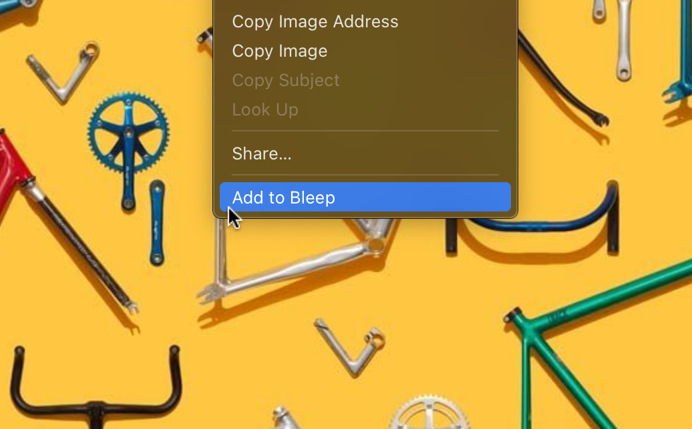
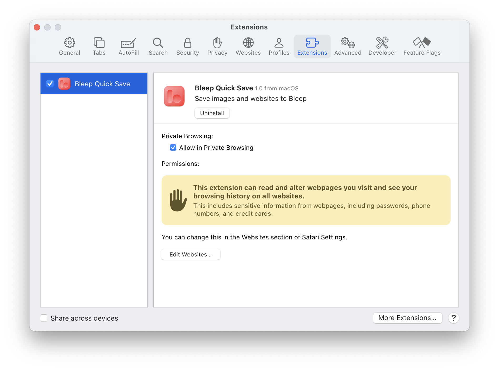
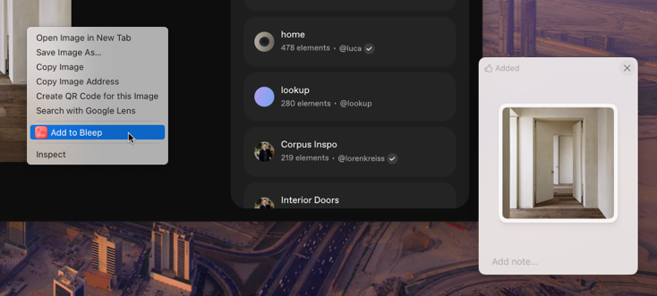

## Install on Chrome (or Dia)

1. [Install extension from Chrome Web Store.](/support/extensions/chrome)  
   Compatible with Dia, or any Chrome-based as well.
2. That's it! You're good to go.

### Important

- Bleep must be running on your computer for the extension to work.
- Since Bleep is a macOS/iOS app, this extension will not work on Windows or Linux.

---

## Install on Safari

The Safari extension comes bundled with the Bleep macOS app. It should prompt you to enable it whenever you open Safari right after installing.

### Manually enabling

1. Open Safari
2. Go to Safari > Settings > Extensions
3. Find "Bleep Quick Save" in the list and enable it

### Important

- Bleep must be running on your computer for the extension to work.
- For best experience, allow access to "All Websites" when prompted.

---

## Install on Firefox (or Zen)

1. [Download Add-on for Firefox.](/extensions/firefox/9bfc2eb6da82413a9eba-1.3.xpi)  
   Compatible with Zen, or any Gecko-based as well.
2. Go to [Add-ons](about:addons) setting.
3. Click on Gear icon on the top right.
4. Click _Install Add-on From File…_
5. Choose the downloaded file.
2. That's it! You're good to go.

### Important

- Bleep must be running on your computer for the extension to work.
- Since Bleep is a macOS/iOS app, this extension will not work on Windows or Linux.

---

## Add Stuff to Bleep

- 🌐 **Websites:**
  - Click the Bleep icon on your browser’s toolbar to save the current website to Bleep. You may need to pin it in Chrome.
  - Right-click on a link (or current page) and select "Add to Bleep".
- 🎆 **Images:** right-click on an image and select "Add to Bleep".
